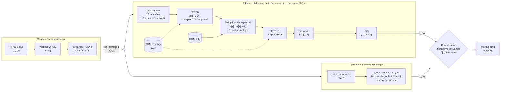
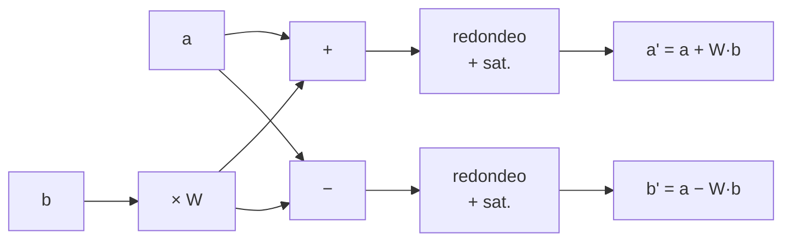

# Arquitectura - Filtro RRC complejo en tiempo y en frecuencia

## 1. Especificación

| Parámetro | Valor |
|---|---|
| Símbolos de entrada | QPSK, `I, Q ∈ {+1, -1}` |
| Filtro | Raíz de coseno realzado (RRC), **8 taps**, roll-off **β = 0.5** |
| Sobremuestreo | `OS = 2` muestras/símbolo → 8 taps abarcan 4 símbolos |
| Filtro en tiempo | FIR directo de 8 taps (complejo: misma `h` real para I y Q) |
| Filtro en frecuencia | Procesamiento por bloques **overlap-save**, FFT de **N = 16**, solapamiento **50 %** (8 muestras nuevas por bloque) |

**¿Por qué N = 16?** Con overlap-save hacen falta `M - 1 = 7` muestras de historia por bloque.
Con 50 % de solapamiento, el bloque es `N = 2L` y la historia son `L = N/2` muestras. La FFT
más chica que cumple `N/2 ≥ 7` es **N = 16** (L = 8).

## 2. Diagrama en bloques del sistema completo

### Detalle del bloque en frecuencia (camino de datos con formatos)

```mermaid
flowchart LR
    X["x[n]<br/>S(8,6)"] --> BUF["Buffer OLS<br/>16 × S(8,6)"]
    BUF --> BR["Reorden<br/>bit-reverso<br/>(cableado)"]
    BR --> S1["Etapa 1<br/>S(11,8)"] --> S2["Etapa 2<br/>S(12,8)"] --> S3["Etapa 3<br/>S(13,8)"] --> S4["Etapa 4<br/>X[k] S(14,8)"]
    S4 --> M["× H[k]<br/>H: S(10,8)<br/>Y: S(14,8)"]
    M --> BR2["Reorden<br/>bit-reverso"]
    BR2 --> I1["IFFT et. 1<br/>÷2 S(14,8)"] --> I2["et. 2<br/>÷2 S(14,8)"] --> I3["et. 3<br/>÷2 S(14,8)"] --> I4["et. 4<br/>÷2 S(14,8)"]
    I4 --> D["Toma y_c[8..15]<br/>y: S(10,8)"]
```

Mariposa radix-2 DIT (la misma en la FFT y en la IFFT; en la IFFT el twiddle va conjugado y se divide por 2):

## 3. Descripción de cada etapa

### 3.1 Generación de estímulos
* **PRBS / bits**: secuencias independientes para I y Q. El modelo de Python usa `numpy.random`
  con semilla fija, para que los resultados sean reproducibles.
* **Mapper QPSK**: `bit → 2·bit − 1`, da símbolos `±1 ± j`.
* **Expansor ↑2**: inserta un cero entre símbolos. `x[n]` entra en formato `S(8,6)`, donde ±1
  es exacto. Se dejan bits fraccionales para poder probar otros estímulos (por ejemplo, ruido).

### 3.2 Filtro RRC (coeficientes)
`h[n]` se calcula con la fórmula cerrada del RRC sobre `t = (n − 3.5)·T/2`, con `n = 0..7`.
El filtro es **simétrico**: `h[n] = h[7−n]`, con fase lineal exacta. El pico (`t = 0`) cae
entre `n = 3` y `n = 4`, es decir, el retardo es de 3.5 muestras. A la salida del transmisor
no hay una muestra justo en el instante de símbolo. En la cascada con el filtro adaptado del
receptor el retardo total es de 7 muestras, un número entero, y el pico vuelve a caer en una
muestra (ver `constelacion.png`).

Medida sobre la cascada TX + RX, la interferencia entre símbolos (ISI) es de −36.9 dB. La
variante anterior (pico en `n = 4`, con `h[0]` sin pareja) da −34.2 dB con filtro adaptado y
−28 dB si el receptor usa el mismo `h`. Esa versión quedó en la rama git `rrc-asimetrico`
(tag `v0-rrc-asimetrico`) y se puede volver a elegir con `RRC_SYMMETRIC = False` en
`config.py`.

Los taps se **normalizan para
que `max|H[k]| = 1`**. Así el filtro no amplifica ninguna frecuencia y `H[k]` entra en el mismo
formato `S(10,8)` que los twiddles. El filtro es real y la señal es compleja, así que I y Q usan
la misma `h`.

### 3.3 Filtro en el dominio del tiempo (FIR, a implementar)
Forma directa: 8 registros de retardo por componente y 8 multiplicadores reales por componente
(16 en total), seguidos de un árbol de sumas. Es la referencia contra la que se va a verificar
el filtro en frecuencia. Ambos deben dar la misma salida, salvo el error de cuantización. En
flotante, la diferencia medida es de ~1e-16.

Como `h` es simétrico, la versión plegada suma primero `x[n−i] + x[n−7+i]` y después
multiplica por `h[i]`, con `i = 0..3`. Así alcanzan **4 multiplicadores por componente**, en
lugar de 8.

### 3.4 Filtro en el dominio de la frecuencia (overlap-save 50 %)

1. **S/P + buffer de solapamiento.** Cada 8 muestras nuevas se arma un bloque de 16: las 8
   anteriores más las 8 nuevas. En hardware son dos bancos de 8 registros complejos: el banco
   "nuevo" pasa a "viejo" en cada bloque.
2. **FFT 16 (radix-2 DIT).** Son 4 etapas de 8 mariposas. Para máxima paralelización, las 32
   mariposas se instancian todas y se puede poner un registro de pipeline entre etapas. Esto
   procesa un bloque de 16 muestras por ciclo de reloj. El reordenamiento bit-reverso es solo
   cableado.
   * **No hay escalado.** Cada etapa crece 1 bit entero (cota `|X_s| ≤ 2^s·√2`), así que no
     puede haber overflow.
   * **Twiddles triviales.** En las etapas 1 y 2 los twiddles son `1` y `−j`, y se resuelven
     sin multiplicadores (negar o intercambiar re/im). Las etapas 3 y 4 sí necesitan
     multiplicadores complejos. Esta optimización es para el RTL: el modelo golden calcula
     todo genéricamente y da el mismo resultado bit a bit.
3. **Multiplicación espectral.** `Y[k] = X[k]·H[k]`, con 16 multiplicadores complejos en
   paralelo. `H[k]` es una ROM (o constantes cableadas), precalculada como la FFT16 de `h`
   rellenado con ceros. Se cuantiza `H` ideal, no la FFT de `h` cuantizado.
4. **IFFT 16.** Usa la misma mariposa con twiddle conjugado (`W⁻ᵏ`) y **÷2 en cada etapa**.
   Eso implementa el `1/N` de la IFFT y hace que el ancho no crezca: `|a ± Wb|/2 ≤ max(|a|,|b|)`.
   El ÷2 es mover el punto fraccional, no cuesta lógica.
   Alternativa equivalente: reusar la misma FFT intercambiando re↔im a la entrada y a la salida.
5. **Descarte + P/S.** Las primeras 8 muestras de la convolución circular tienen aliasing y se
   descartan. Las últimas 8 son la salida válida. El resultado coincide muestra a muestra con
   `np.convolve(x, h)[:len(x)]`.

### 3.5 Cuantización
Cada mariposa y cada multiplicador hacen la operación a **ancho completo** y redondean una sola
vez a la salida. El redondeo es *half-up*: `(v + 2^(s−1)) >>> s`. La saturación está como
protección, pero los anchos se eligen por cotas de peor caso y el contador de overflow da 0 en
todos los datasets.

| Nodo | Formato | Justificación |
|---|---|---|
| x[n] | S(8,6) | ±1 exacto; 1 bit entero |
| Twiddles, H[k] | S(10,8) | Representan +1 exacto. Con 10 bits, por sí solos limitan el SQNR a 63 dB (twiddles) y 52 dB (H), por encima de los ~49 dB que da el camino de datos con NBF_D=8 |
| FFT etapa s | S(10+s, 8) | 1 bit entero más por etapa |
| Y[k], IFFT | S(14,8) | `|Y| ≤ 16·√2·max|H| = 22.6` → 5 bits enteros |
| y[n] | S(10,8) | `|y| ≤ √2·Σ|h| = 1.83` → 1 bit entero |

Todos los anchos salen de `make_cfg()` en [`python_math/config.py`](../python_math/config.py) a partir
de 3 parámetros: `NBF_D` (bits fraccionales internos), `NB_TW` y `NB_H`. El barrido de SQNR
contra estos parámetros está en [resultados.md](resultados.md).

### 3.6 Comparación e interfaz serie (a implementar)
Las salidas del FIR en tiempo y del filtro en frecuencia se comparan contra los vectores
golden (`vectors/`). La interfaz serie (UART) carga estímulos y lee resultados desde la PC.

## 4. Throughput y latencia del filtro en frecuencia

* Con FFT/IFFT totalmente paralelas y pipeline por etapa, se procesa **1 bloque por ciclo**:
  son 8 muestras de salida por ciclo de reloj.
* La latencia algorítmica es de 1 bloque (esperar 8 muestras nuevas) más la profundidad del
  pipeline: 4 (FFT) + 1 (mult.) + 4 (IFFT) etapas.
