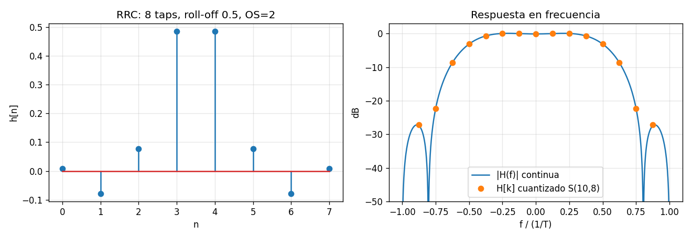
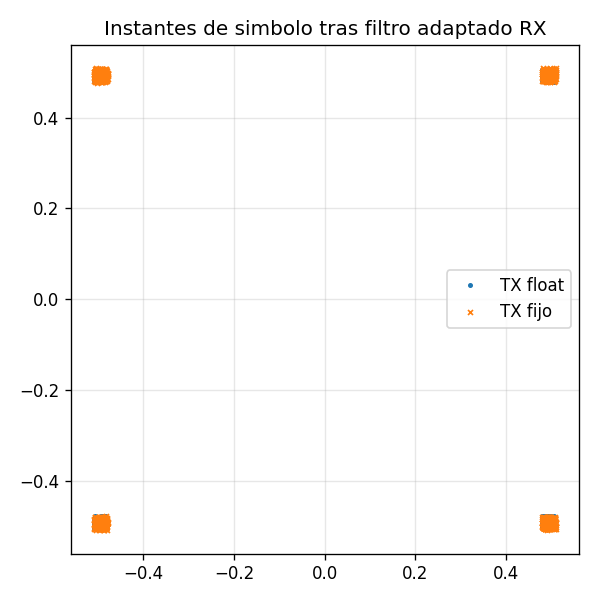

# Resultados del modelo golden (generado por `python_math/run_math.py`)

## Coeficientes RRC normalizados (max|H[k]| = 1)

| n | 0 | 1 | 2 | 3 | 4 | 5 | 6 | 7 |
|---|---|---|---|---|---|---|---|---|
| h[n] | +0.0077 | -0.0779 | +0.0779 | +0.4843 | +0.4843 | +0.0779 | -0.0779 | +0.0077 |

## Formatos de punto fijo por nodo

| Nodo | Formato | dtype fxpmath | Bits enteros |
|---|---|---|---|
| x[n] entrada | S(8,6) | `fxp-s8/6` | 1 |
| twiddle W | S(10,8) | `fxp-s10/8` | 1 |
| H[k] ROM | S(10,8) | `fxp-s10/8` | 1 |
| FFT etapa 1 | S(11,8) | `fxp-s11/8` | 2 |
| FFT etapa 2 | S(12,8) | `fxp-s12/8` | 3 |
| FFT etapa 3 | S(13,8) | `fxp-s13/8` | 4 |
| FFT etapa 4 | S(14,8) | `fxp-s14/8` | 5 |
| Y[k]=X[k]H[k] | S(14,8) | `fxp-s14/8` | 5 |
| IFFT etapa 1 | S(14,8) | `fxp-s14/8` | 5 |
| IFFT etapa 2 | S(14,8) | `fxp-s14/8` | 5 |
| IFFT etapa 3 | S(14,8) | `fxp-s14/8` | 5 |
| IFFT etapa 4 | S(14,8) | `fxp-s14/8` | 5 |
| y[n] salida | S(10,8) | `fxp-s10/8` | 1 |

Redondeo: `round` (half-up) - Overflow: `sat`

## Float vs punto fijo (2048 simbolos por dataset)

| Dataset | max\|FIR tiempo - OLS float\| | SQNR fijo vs float [dB] | Error max [LSB salida] | Pico salida | Overflows |
|---|---|---|---|---|---|
| random_a | 3.6e-16 | 48.9 | 2.08 | 0.648 | 0 |
| random_b | 3.5e-16 | 48.9 | 2.08 | 0.648 | 0 |
| impulse | 7.9e-17 | 39.7 | 1.03 | 0.484 | 0 |
| constant | 1.6e-16 | 67.6 | 1.05 | 0.570 | 0 |
| alternating | 1.1e-16 | 68.0 | 1.05 | 0.562 | 0 |
| worst_case | 2.4e-16 | 51.1 | 1.14 | 0.648 | 0 |

## Barrido de anchos (dataset random_a)

| NBF_D | SQNR redondeo [dB] | SQNR truncado [dB] |
|---|---|---|
| 2 | 13.8 | 7.7 |
| 3 | 19.8 | 13.7 |
| 4 | 24.7 | 19.6 |
| 5 | 30.6 | 25.8 |
| 6 | 36.0 | 31.9 |
| 7 | 47.4 | 37.6 |
| 8 | 53.3 | 43.8 |
| 9 | 56.3 | 49.9 |
| 10 | 61.0 | 55.7 |
| 11 | 67.0 | 61.7 |
| 12 | 72.9 | 67.5 |
| 13 | 78.4 | 72.9 |
| 14 | 84.4 | 77.3 |

| Bits | SQNR vs NB_TW [dB] | SQNR vs NB_H [dB] |
|---|---|---|
| 4 | 18.8 | 20.4 |
| 5 | 25.5 | 23.5 |
| 6 | 31.8 | 31.0 |
| 7 | 33.9 | 34.4 |
| 8 | 42.2 | 39.0 |
| 9 | 46.0 | 51.5 |
| 10 | 60.8 | 54.0 |
| 11 | 77.2 | 58.9 |
| 12 | 77.2 | 66.2 |
| 13 | 77.2 | 72.6 |
| 14 | 76.2 | 77.4 |
| 15 | 81.5 | 81.6 |
| 16 | 84.4 | 84.4 |

