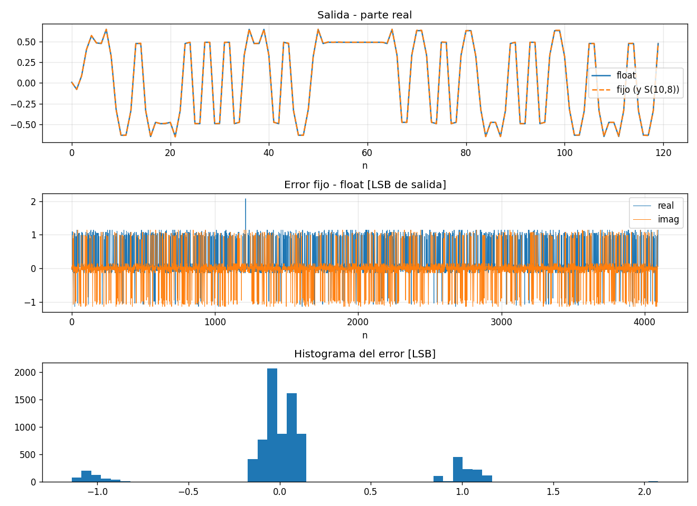
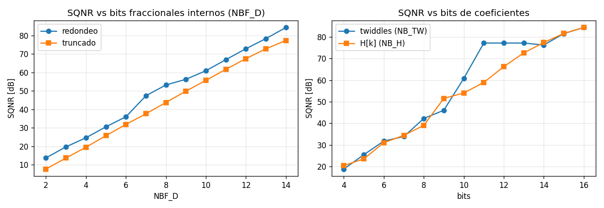

# Resultados del modelo con fxpmath (generado por `run_math.py`)

## Formatos

| Nodo | Formato | dtype fxpmath |
|---|---|---|
| x[n] entrada | S(8,6) | `fxp-s8/6` |
| twiddle W | S(10,8) | `fxp-s10/8` |
| H[k] ROM | S(10,8) | `fxp-s10/8` |
| FFT etapa 1 | S(11,8) | `fxp-s11/8` |
| FFT etapa 2 | S(12,8) | `fxp-s12/8` |
| FFT etapa 3 | S(13,8) | `fxp-s13/8` |
| FFT etapa 4 | S(14,8) | `fxp-s14/8` |
| Y[k]=X[k]H[k] | S(14,8) | `fxp-s14/8` |
| IFFT etapa 1 | S(14,8) | `fxp-s14/8` |
| IFFT etapa 2 | S(14,8) | `fxp-s14/8` |
| IFFT etapa 3 | S(14,8) | `fxp-s14/8` |
| IFFT etapa 4 | S(14,8) | `fxp-s14/8` |
| y[n] salida | S(10,8) | `fxp-s10/8` |

## Float vs punto fijo (2048 simbolos por dataset)

| Dataset | max\|FIR - OLS float\| | SQNR [dB] | Error max [LSB] | Overflows |
|---|---|---|---|---|
| random_a | 3.7e-16 | 48.9 | 2.08 | 0 |
| random_b | 3.5e-16 | 48.9 | 2.08 | 0 |
| impulse | 7.9e-17 | 39.7 | 1.03 | 0 |
| constant | 1.6e-16 | 67.6 | 1.05 | 0 |
| alternating | 1.1e-16 | 68.0 | 1.05 | 0 |
| worst_case | 2.4e-16 | 51.1 | 1.14 | 0 |

Tiempo de `run()` con 2048 simbolos: 404 ms

## Comparacion bit a bit contra los vectores de referencia (`../vectors`)

**74 / 74 archivos identicos.**

| Archivo | Identico |
|---|---|
| alternating\blk_in.hex | si |
| alternating\fft_st1.hex | si |
| alternating\fft_st2.hex | si |
| alternating\fft_st3.hex | si |
| alternating\fft_st4.hex | si |
| alternating\ifft_st1.hex | si |
| alternating\ifft_st2.hex | si |
| alternating\ifft_st3.hex | si |
| alternating\ifft_st4.hex | si |
| alternating\spec_mult.hex | si |
| alternating\x_in.hex | si |
| alternating\y_out.hex | si |
| constant\blk_in.hex | si |
| constant\fft_st1.hex | si |
| constant\fft_st2.hex | si |
| constant\fft_st3.hex | si |
| constant\fft_st4.hex | si |
| constant\ifft_st1.hex | si |
| constant\ifft_st2.hex | si |
| constant\ifft_st3.hex | si |
| constant\ifft_st4.hex | si |
| constant\spec_mult.hex | si |
| constant\x_in.hex | si |
| constant\y_out.hex | si |
| impulse\blk_in.hex | si |
| impulse\fft_st1.hex | si |
| impulse\fft_st2.hex | si |
| impulse\fft_st3.hex | si |
| impulse\fft_st4.hex | si |
| impulse\ifft_st1.hex | si |
| impulse\ifft_st2.hex | si |
| impulse\ifft_st3.hex | si |
| impulse\ifft_st4.hex | si |
| impulse\spec_mult.hex | si |
| impulse\x_in.hex | si |
| impulse\y_out.hex | si |
| random_a\blk_in.hex | si |
| random_a\fft_st1.hex | si |
| random_a\fft_st2.hex | si |
| random_a\fft_st3.hex | si |
| random_a\fft_st4.hex | si |
| random_a\ifft_st1.hex | si |
| random_a\ifft_st2.hex | si |
| random_a\ifft_st3.hex | si |
| random_a\ifft_st4.hex | si |
| random_a\spec_mult.hex | si |
| random_a\x_in.hex | si |
| random_a\y_out.hex | si |
| random_b\blk_in.hex | si |
| random_b\fft_st1.hex | si |
| random_b\fft_st2.hex | si |
| random_b\fft_st3.hex | si |
| random_b\fft_st4.hex | si |
| random_b\ifft_st1.hex | si |
| random_b\ifft_st2.hex | si |
| random_b\ifft_st3.hex | si |
| random_b\ifft_st4.hex | si |
| random_b\spec_mult.hex | si |
| random_b\x_in.hex | si |
| random_b\y_out.hex | si |
| rom\H.hex | si |
| rom\twiddle.hex | si |
| worst_case\blk_in.hex | si |
| worst_case\fft_st1.hex | si |
| worst_case\fft_st2.hex | si |
| worst_case\fft_st3.hex | si |
| worst_case\fft_st4.hex | si |
| worst_case\ifft_st1.hex | si |
| worst_case\ifft_st2.hex | si |
| worst_case\ifft_st3.hex | si |
| worst_case\ifft_st4.hex | si |
| worst_case\spec_mult.hex | si |
| worst_case\x_in.hex | si |
| worst_case\y_out.hex | si |

## Barridos de SQNR

| NBF_D | redondeo | truncado |
|---|---|---|
| 2 | 13.8 | 7.7 |
| 3 | 19.8 | 13.7 |
| 4 | 24.7 | 19.6 |
| 5 | 30.6 | 25.8 |
| 6 | 36.0 | 31.9 |
| 7 | 47.4 | 37.6 |
| 8 | 53.3 | 43.8 |
| 9 | 56.3 | 49.9 |
| 10 | 61.0 | 55.7 |
| 11 | 67.0 | 61.7 |
| 12 | 72.9 | 67.5 |
| 13 | 78.4 | 72.9 |
| 14 | 84.4 | 77.3 |

