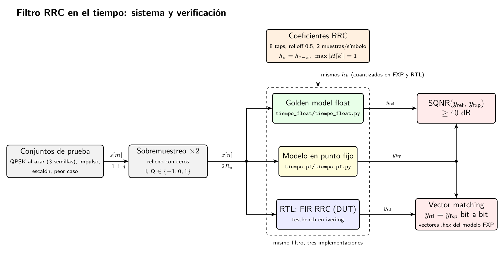
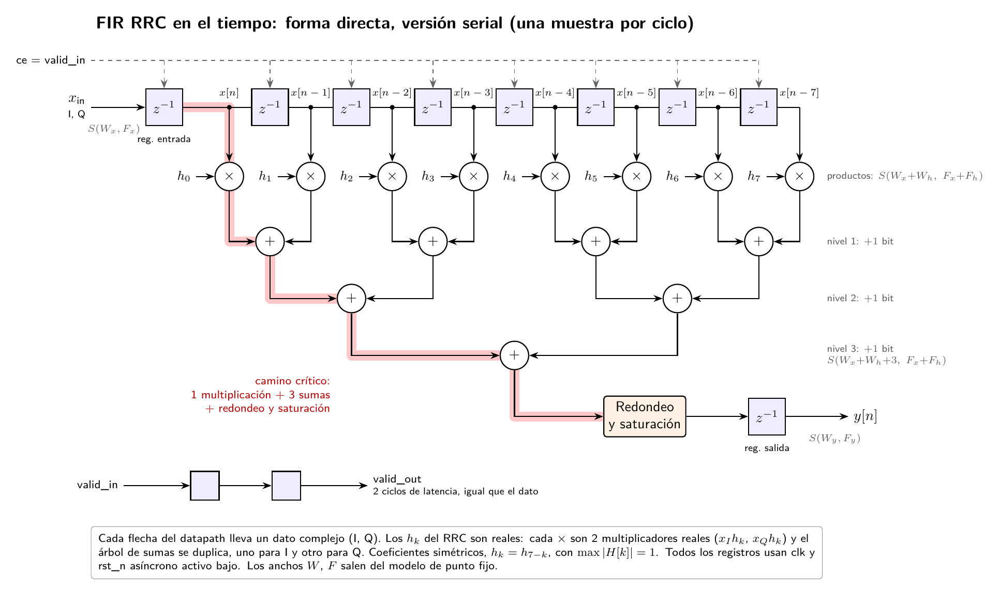

# Golden model float: filtro RRC en el tiempo

- `comun.py`: parámetros del filtro (8 taps, rolloff 0,5, 2 muestras por símbolo), coeficientes RRC normalizados con max|H[k]| = 1 en la FFT de 16, y las señales de prueba (impulso en I y en Q, escalón, peor caso y 3 secuencias QPSK al azar).
- `tiempo_float.py`: filtra cada señal muestra por muestra con un FIR en forma directa, lo compara con `np.convolve`, verifica la respuesta al impulso y la cota de salida (0,648), calcula la respuesta en frecuencia y grafica los coeficientes, |H| y la entrada/salida QPSK.

Para correrlo:

```bash
python tiempo_float.py
```

## Diagramas

En `diagramas/` (el `.tex` es la fuente, se compila con `pdflatex`):

- `tiempo_sistema.png`: el sistema completo, desde los símbolos QPSK y el sobremuestreo hasta las tres implementaciones del filtro (float, punto fijo y RTL) y cómo se comparan (SQNR y vector matching).
- `tiempo_datapath.png`: el datapath del FIR en forma directa, versión serial: línea de retardo, 8 multiplicadores, árbol de sumas, redondeo y saturación, y el camino crítico.




